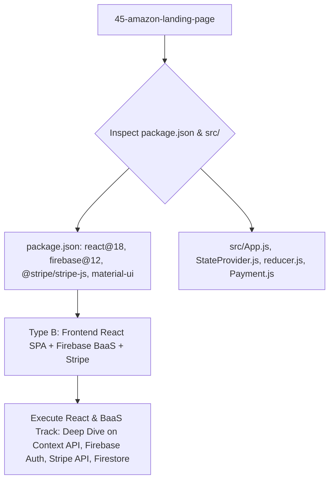

# Project Type Pre-Check: 45-Amazon-Landing-Page

## Step 0 Pre-Check Analysis

- **Detected Track**: **Track B: Frontend React Application with Firebase Backend-as-a-Service (BaaS) & Stripe Payments**
- **Project Root**: `/Users/avishjain/avishjain9-repos/45-amazon-landing-page`
- **Application Directory**: `amazon landing page /amazonself/`
- **Primary Domain**: Production-grade full e-commerce clone of Amazon featuring user authentication, shopping basket state management, Stripe payment intents, and Firestore order history.

### Evidence Matrix

| Evidence Factor | Codebase Artifact | Concrete Findings | Verdict |
|---|---|---|---|
| **Package Dependencies** | `amazonself/package.json` | `react@^18.3.1`, `firebase@^12.8.0`, `@stripe/stripe-js@^7.9.0`, `@material-ui/core@^4.11.0` | React Single Page Application utilizing Firebase for backend services and Stripe for transactions. |
| **Backend Code** | Entire Repository | Uses Google Cloud Firebase (Cloud Firestore & Firebase Auth) and external Stripe API. No custom Express listener. | **Serverless / BaaS Track**. |
| **Database Layer** | `amazonself/src/firebase.js` | Cloud Firestore NoSQL document database (`db.collection('users')`). | NoSQL Document Store. |
| **State Management** | `amazonself/src/StateProvider.js` | React Context API combined with `useReducer` pattern mimicking Redux. | Native React Global State. |
