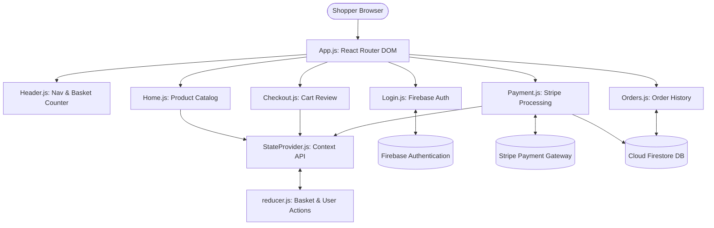

# Full Project Analysis: Amazon E-Commerce Platform

## 0.1 What the Project Is

**Amazon Clone** is a full-featured e-commerce web platform replicating Amazon's core transactional funnel. Built with React 18, the Context API, Firebase Auth, Cloud Firestore, and Stripe, it provides a seamless shopping experience: browsing catalog products, real-time shopping cart additions, checkout subtotal calculations, secure card processing, and persistent order receipts.

### Main User Journeys

```mermaid
journey
    title Shopper Journey
    section Authentication
      Visit Login route (/login): 5: Customer
      Sign In or Create Account with Firebase: 5: Customer
    section Product Discovery
      Browse Home hero carousel: 5: Customer
      Inspect product card star ratings: 4: Customer
      Click 'Add to Basket': 5: Customer
      Cart badge increments in Header: 5: Customer
    section Checkout & Payment
      Navigate to /checkout: 5: Customer
      Review items & calculate subtotal: 5: Customer
      Proceed to /payment: 5: Customer
      Enter card details via Stripe CardElement: 5: Customer
      Firestore records order; basket clears: 5: Customer
      Redirected to /orders: 5: Customer
```

---

## 0.2 Master Feature Inventory & Traces

### System Overview Diagram



### F1: Global Shopping Basket State Management (Context API + useReducer)
- **User Action**: Clicking "Add to Basket" on any product dispatches action; header badge increments; checkout view lists items.
- **Trace**: `Product.js:L18` (`addToBasket`) -> `StateProvider.js:L16` (`useStateValue`) -> `reducer.js:L9` (`ADD_TO_BASKET`, `REMOVE_FROM_BASKET`, `EMPTY_BASKET`).

### F2: User Authentication via Firebase Auth
- **User Action**: User enters email & password at `/login`; can either "Sign In" or "Create your Amazon Account".
- **Trace**: `Login.js:L15` (`signIn`, `register`) -> `firebase.js:L24` (`auth.signInWithEmailAndPassword`, `auth.createUserWithEmailAndPassword`) -> `App.js:L22` (`auth.onAuthStateChanged` syncs user to Context).

### F3: Stripe CardElement Payment & Firestore Transaction Recording
- **User Action**: At `/payment`, enters credit card details via Stripe Elements; submits; card is charged, Firestore logs the transaction under `users/:uid/orders/:orderId`, basket is emptied, user redirected to `/orders`.
- **Trace**: `Payment.js:L35` (`handleSubmit`) -> Stripe SDK `stripe.confirmCardPayment` -> Cloud Firestore `db.collection('users').doc(user?.uid).collection('orders').doc(paymentIntent.id).set()`.

---

## 0.3 Final Inventory Counts

| Architectural Metric | Count | Code Verification Reference |
|---|---|---|
| **React Components** | 12 | `App.js`, `Header.js`, `Home.js`, `Product.js`, `Checkout.js`, `Subtotal.js`, `CheckoutProduct.js`, `Login.js`, `Payment.js`, `Orders.js`, `Order.js`, `StateProvider.js` |
| **Application Routes** | 5 | `/`, `/checkout`, `/login`, `/payment`, `/orders` in `App.js` |
| **Reducer Action Types** | 4 | `ADD_TO_BASKET`, `REMOVE_FROM_BASKET`, `EMPTY_BASKET`, `SET_USER` in `reducer.js` |
| **Third-Party Cloud Services** | 2 | Firebase (Auth + Firestore), Stripe (Payment Gateway) |
| **Dependencies** | 15 | Listed in `amazon landing page /amazonself/package.json` |
