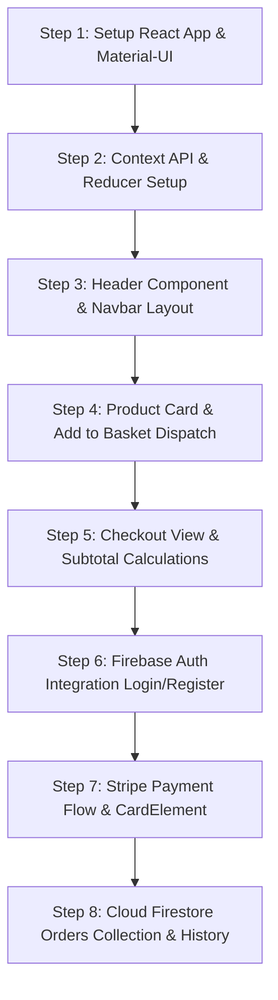

# Step-by-Step Rebuild Guide: Amazon Clone

Constructing the Amazon Clone from scratch in strict architectural dependency order:



### Key Snippet: Global Context Provider (`src/StateProvider.js`)

```javascript
import React, { createContext, useContext, useReducer } from "react";

// Prepares the dataLayer
export const StateContext = createContext();

// Wrap our app and provide the Data layer
export const StateProvider = ({ reducer, initialState, children }) => (
  <StateContext.Provider value={useReducer(reducer, initialState)}>
    {children}
  </StateContext.Provider>
);

// Pull information from the data layer
export const useStateValue = () => useContext(StateContext);
```
