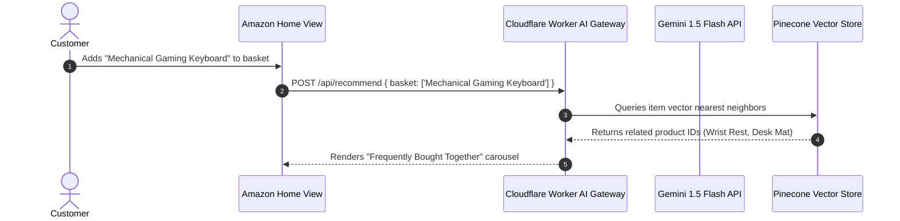

# AI Integration Analysis: Amazon Clone

## Current Status: No AI Integration

The repository currently contains **No AI integration**. Products are statically populated in `Home.js`.

---

## Architectural Blueprint: AI Personalized Recommendation & Visual Product Search

