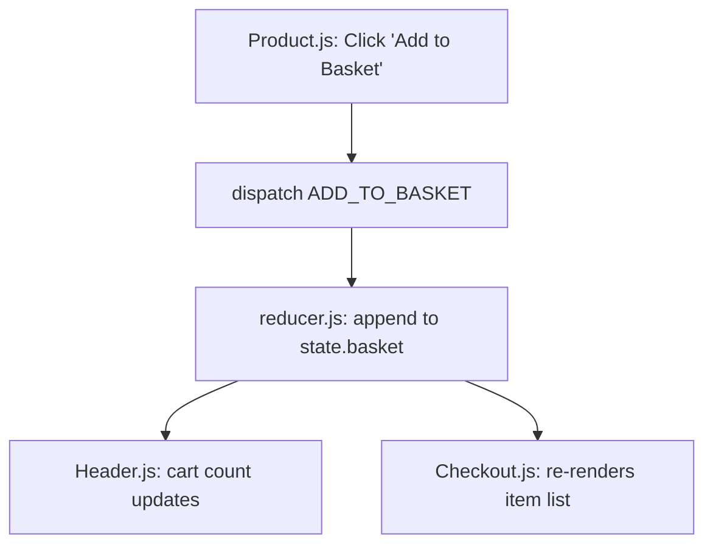

# F1: Global Shopping Basket State Management

## Overview & Architecture
Centralized shopping basket state managed via React Context and `useReducer` in `StateProvider.js` and `reducer.js`.

## Say It Out Loud
> "I built the global shopping cart state using React's Context API and the `useReducer` hook in `StateProvider.js` and `reducer.js`. When a customer clicks 'Add to Basket' on any product card, the component dispatches an `ADD_TO_BASKET` action containing the item metadata. The reducer creates a new immutable basket array by spreading previous items alongside the new payload. In `Header.js`, the cart count badge subscribes to the basket slice of state, instantly re-rendering the updated number without prop drilling."
