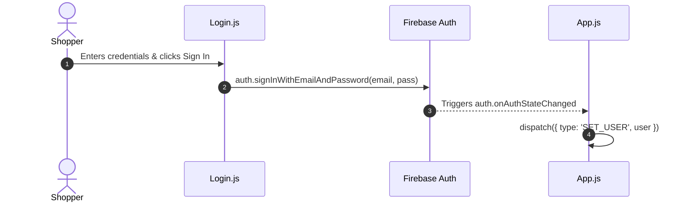

# F2: Firebase User Authentication

## Overview & Architecture
Handles user sign-in and account registration using Firebase Auth with session persistence.

## Say It Out Loud
> "For user authentication in `Login.js`, I integrated Firebase Auth. Users can sign in or register a new account using email and password credentials. When submitted, the component calls `auth.signInWithEmailAndPassword` or `auth.createUserWithEmailAndPassword`. In `App.js`, I registered an `auth.onAuthStateChanged` observer inside a `useEffect` hook. Whenever authentication state mutates—upon login, session renewal, or logout—the observer automatically dispatches a `SET_USER` action into the Context API data layer, ensuring the active user object is globally available across all views."
