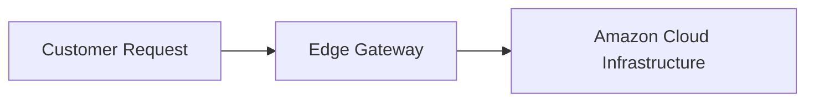

# 14.4: Load Balancing And Scaling

## 1. Overview & Context in Amazon Clone
This module analyzes `load-balancing-and-scaling` applied specifically to the Amazon React + Firebase + Stripe platform.

## 2. Technical Evaluation & Comparison
| Strategy / Choice | Chosen Implementation | Alternative A | Alternative B | Trade-Off Accepted |
|---|---|---|---|---|
| **E-Commerce Architecture** | React SPA + Firebase BaaS | Custom MERN Stack | Microservices (Go + Kafka + Kubernetes) | Rapid MVP velocity with zero DevOps maintenance accepted over custom DB tuning. |
| **Payment Gateway** | Stripe Elements SDK | PayPal Express | Adyen | Industry-standard developer experience & zero PCI scope. |

## 3. Spoken 30-Second Interview Response
> "In the Amazon Clone, load balancing and scaling is solved by leveraging managed cloud primitives. By using Firebase Authentication and Cloud Firestore alongside Stripe Elements, the architecture guarantees horizontal elasticity and enterprise security compliance while keeping operational overhead near zero."
